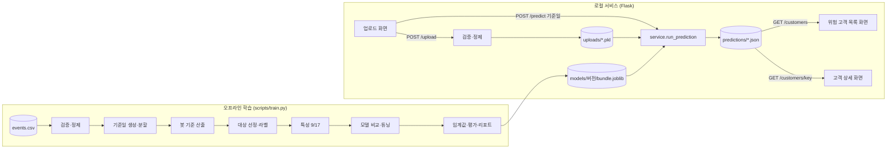

# 고객 이탈 예측 프로그램 아키텍처 (v1, 2026-10-25)

통합 계획서(예측 대상과 이탈 정의, 9·17개 특성, 평가 기준)를 그대로 구현하는 로컬 Flask 서비스 + 오프라인 학습 구조.

## 1. 전체 구성



학습과 예측은 **같은 함수**(`validate`, `daily`, `sampling`, `features`)를 사용한다. 학습용과 예측용 특성 계산을 따로 짜면 값이 미묘하게 달라지는 버그가 생기기 때문이다.

## 2. 핵심 정의 (config.py에 상수로 고정)

| 구분 | 정의 | 코드 |
|---|---|---|
| 날짜 | UTC 날짜 단위. 수집 첫날·마지막 날은 불완전일로 제외 | `daily.complete_date_range` |
| 활동 | 조회·장바구니·구매 중 1건 이상 있는 날 | `daily.activity_matrix` |
| 기준일 D | 관찰 D-29 ~ D (30일) | `OBS_DAYS = 30` |
| 예측 대상 | D-7 활동 + D-6~D 7일 연속 미활동 + D-29~D-7에 7일 연속 미활동 없음 | `sampling.target_mask` |
| 예측 기간 | D+1 ~ D+7 | `PRED_DAYS = 7` |
| 라벨 | 예측 기간 활동 0일 → 1(이탈), 1일 이상 → 0(유지) | `sampling.label` |
| 표본 | (이용자 ID, 기준일). 기준일마다 대상 조건 재적용 | `sampling.build_training_samples` |
| 세그먼트 | 관찰 30일 구매 거래 ≥ 1 → purchased, 0 → non_purchased | `features.build_features` |

정의가 바뀌면 `config.py`와 `tests/test_sampling.py`부터 고친다.

## 3. 폴더 구조

```
churn-app/
├─ config.py                 기간 정의·검증 규칙·평가 목표·등급 구간 등 모든 상수
├─ churn/                    코어 패키지 (학습·서비스 공용)
│  ├─ validate.py            1단계 업로드 검증·정제
│  ├─ daily.py               2~4단계 날짜 변환, 불완전일, 봇, 활동 행렬
│  ├─ sampling.py            5~7단계 기준일, 대상 선정, 라벨, 제외 사유
│  ├─ features.py            8단계 9개/17개 특성, 한글 라벨
│  ├─ split.py               10단계 기준일 시간순 분할(경계 7일 간격)
│  ├─ models.py              전원 이탈 / 로지스틱 회귀 / XGBoost + 랜덤 서치
│  ├─ evaluate.py            지표, 임계값 선정, 세그먼트별 평가, 과적합·누수 점검
│  ├─ explain.py             고객별 기여도(TreeSHAP), 전체 요인
│  ├─ privacy.py             customer_key(해시) / display_id(마스킹)
│  ├─ storage.py             JSON·모델 파일 저장
│  └─ service.py             업로드 + 기준일 → 예측 결과 (Flask가 호출)
├─ scripts/
│  ├─ train.py               오프라인 학습·평가·리포트
│  └─ make_synthetic.py      개발용 합성 데이터
├─ app/
│  ├─ main.py                Flask: JSON API + 화면 라우트
│  ├─ templates/             upload / results / customer (Jinja)
│  └─ static/style.css
├─ tests/test_sampling.py    대상·라벨 정의 단위 테스트
└─ data/                     (실행 시 생성) raw / uploads / predictions / models / reports
```

## 4. 모듈 명세

| 모듈 | 주요 함수 | 입력 → 출력 |
|---|---|---|
| validate | `load_and_validate(path)` | CSV/XLSX → (정제 DataFrame, 검증 리포트) |
| daily | `add_date`, `trim_incomplete_days`, `bot_threshold`, `bot_users`, `activity_matrix` | 이벤트 → 이용자×날짜 0/1 행렬 |
| sampling | `target_mask(mat, d)`, `label(mat, d)`, `training_reference_dates`, `build_training_samples` | 행렬 → 대상 여부·제외 사유·라벨 |
| features | `build_features(events, samples)` | (visitorid, ref_date) → 17개 특성 + segment |
| split | `split_reference_dates`, `split_samples`, `describe_split` | 기준일 → train/val/test, 표본 수·고유 이용자 수 |
| models | `AllChurnBaseline`, `make_logreg`, `fit_xgb`, `random_search` | 학습 자료 → 모델, 튜닝 이력 |
| evaluate | `choose_threshold`, `evaluate`, `goal_check`, `diagnostics` | 확률 → 지표(전체·세그먼트), 점검 신호 |
| explain | `contributions`, `factor_list`, `global_importance` | 모델+특성 → 기여도(로그오즈) |
| service | `run_prediction(events, 기준일, bundle)` | → {summary, customers[]} |

## 5. 학습 흐름 (scripts/train.py)

| 단계 | 내용 |
|---|---|
| 1 | 업로드와 같은 규칙으로 검증 → 불완전한 첫날·마지막 날 제거 |
| 2 | 기준일 생성(관찰 30일 + 예측 7일 확보) → 기준일 시간순 60/20/20 분할, 경계마다 7일 간격 |
| 3 | 봇 기준값 = 학습 구간 이용자-일 행동 건수 상위 0.1% (최소 100건/일) |
| 4 | 기준일마다 대상 선정 + 라벨 → 특성 17개 계산 |
| 5 | 비교: 전원 이탈 / 로지스틱 회귀 9·17 / XGBoost 9·17 (랜덤 서치, early stopping) |
| 6 | 모델별 임계값 = 검증 자료에서 Recall ≥ 0.70 중 Precision 최대 |
| 7 | 검증 PR-AUC 최고 모델 선택 → 테스트 자료로 1회 평가 (전원 이탈·로지스틱 회귀와 함께) |
| 8 | 저장: `bundle.joblib`, `meta.json`, `tuning_history.csv`(파라미터별 그래프용), `reports/버전.md` |

## 6. 예측 흐름 (service.run_prediction)

1. 기준일 범위 확인: 관찰 30일이 온전히 있는 날짜만 허용 (아니면 422)
2. D 이후 기록은 무시 → 관찰 구간만 사용
3. 봇 제외(학습 때 기준값) → 대상 선정, **제외 사유별 인원** 집계
4. 특성 → 확률 → 위험 등급(high ≥ 0.60 / medium ≥ 0.35 / low) → 이탈 판정(임계값)
5. 고객별 기여도, 30일 일별 활동, 전체 요인 → `predictions/{id}.json` 저장

## 7. API

| 방식 | 경로 | 요청 | 응답 요점 |
|---|---|---|---|
| POST | /upload | multipart `file` | upload_id, n_rows, n_valid_rows, n_visitors, period, reference_date_range, validation{status, errors, warnings} |
| POST | /predict | {upload_id, reference_date, model_version?} | prediction_id, n_targets, n_excluded(사유별), n_by_segment, n_by_risk, n_predicted_churn, threshold |
| GET | /customers | prediction_id, segment?, risk_level?, page, size | total, items[{customer_key, display_id, segment, churn_prob, risk_level, predicted_churn, last_active_date, top_factor}] |
| GET | /customers/{customer_key} | prediction_id | profile, daily_activity[30], base_value, factors[{feature, label, value, shap, direction}] |

공통 에러: 400 / 404 / 413 / 422 + `{"error": {"code", "message", "details"}}`

## 8. 저장 구조

| 경로 | 내용 |
|---|---|
| data/uploads/{id}.csv·.pkl·.json | 원본 / 정제본 / 검증 리포트 |
| data/predictions/{id}.json | 예측 요약 + 고객별 결과·설명 |
| data/models/{버전}/ | bundle.joblib, meta.json, tuning_history.csv |
| data/models/LATEST | 기본 모델 버전 |
| data/reports/{버전}.md | 학습 리포트(분할, 검증·테스트 성능표, 세그먼트, 목표 달성, 점검, 전체 요인) |

visitorid 원값은 화면·API에 노출하지 않는다(customer_key = salt 포함 SHA-256 앞 16자, display_id = 끝 2자리 마스킹).

## 9. 계획서에 없어 기본값으로 정한 것

| 항목 | 기본값 | 위치 |
|---|---|---|
| 불완전일 판정 | 수집 첫날·마지막 날 무조건 제외 | daily.complete_date_range |
| 봇 기준 | 이용자-일 행동 상위 0.1%, 단 최소 100건/일 | config.BOT_* |
| 기준일 간격 | 1일 (7일로 바꾸려면 `--stride 7`) | config.REFERENCE_STRIDE_DAYS |
| 분할 비율 | 기준일 개수 60/20/20 (경계 간격 제외 후) | config.SPLIT_RATIOS |
| 모델 선택 | 검증 PR-AUC 최고 (로지스틱 회귀가 이기면 그것을 선택) | train.py |
| 최종 재학습 | 하지 않음 (학습 자료로 학습, 검증으로 early stopping) | train.py |
| 위험 등급 | high ≥ 0.60 / medium ≥ 0.35 / low | config.RISK_* |
| 업로드 제한 | 200MB, 행 오류 5% 초과 시 거부 | config |
| Accuracy | `accuracy_ref`, `balanced_accuracy_ref`로 참고 보고만 | evaluate.metrics_at |

## 10. 검증 상태와 한계

- 합성 데이터(80만 행, 98일)로 학습 → 업로드 → 예측 → 목록·상세 화면까지 실행 확인. 대상·라벨 정의 단위 테스트 8개 통과.
- **이 작업 환경에는 XGBoost를 설치할 수 없어** 검증은 scikit-learn HistGradientBoosting 대체 경로로 했다. `pip install xgboost` 후 같은 명령으로 실행하면 XGBoost + 내장 TreeSHAP 경로를 탄다. 첫 실행에서 이 경로를 꼭 확인할 것.
- 로지스틱 회귀나 대체 모델이 선택되면 고객별 기여도는 "중앙값 치환" 근사치다(TreeSHAP 아님).
- 합성 데이터의 성능 수치는 의미가 없다. 실제 Retail Rocket으로 다시 학습해야 한다.

## 11. 실행

```bash
pip install -r requirements.txt
python scripts/train.py --events data/raw/events.csv          # 학습 (실제 데이터)
python -m app.main                                             # http://127.0.0.1:5000
# 개발용: python scripts/make_synthetic.py && python scripts/train.py --events data/raw/synthetic_events.csv
```

## 12. 역할 분담 제안 (26일 작업)

| 담당 | 파일 |
|---|---|
| 이서준 (백엔드) | app/main.py, churn/service.py, storage.py, 통합 테스트 |
| 유은서 (데이터·예측 설계) | churn/daily.py, sampling.py, features.py, 실제 데이터 집계 |
| 김현서 (UI/UX) | app/templates/*, static/style.css, SHAP 시각화 방식 |
| 진찬우 | scripts/train.py, evaluate.py, 튜닝 그래프·기술서 성능표 |